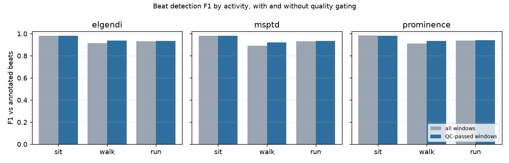

# pulse-qc

A small, tested harness for **data-quality gating and beat detection on open pulsatile
physiological waveforms** (PPG today; ABP and ICP are on the list). It downloads a few
public PhysioNet records, runs explicit, versioned quality rules on every 10-second window,
runs three beat detectors on the same cached inputs, and scores them against
human-verified beat annotations, with and without quality gating.

I built it because I care about brain and physiological monitoring, and because the part
of measurement I find most interesting is the unglamorous one: deciding which stretches of
a signal deserve to be trusted before any headline number is computed from them. This repo
is an engineering and analysis exercise in that direction. It is not research and it is not
a product.

## Limits

- **Not a medical device, not validated, no clinical claims.** Nothing here has been
  evaluated for any clinical use. It is an educational and engineering demonstration.
- **Small evaluation set.** Six subjects, three activities each, from one dataset
  (the Pulse Transit Time PPG set). The numbers below describe those 18 records, not PPG
  in general.
- **The `periodicity` rule was tuned on the evaluation data.** The five acquisition-fault
  rules (dropout, gaps, flatline, clipping, implausible range) never fire on this
  lab-grade dataset, so the only rule that changes the scores is a periodicity heuristic
  whose threshold I chose after looking at the same six subjects. The "QC-passed" scores
  are therefore optimistic and should be read as "what gating of this kind can do", not
  as a measured generalisation.
- **Reference beats are ECG R-peaks, not PPG peaks.** The scorer removes one constant
  lag per record (the median R-to-pulse delay, about 0.3 s here) and then matches within
  ±100 ms. Beat-to-beat changes in pulse arrival time count against the detector.
- **No cerebral signals yet.** The datasets have no cerebral blood flow or ICP; the link to
  neuro-monitoring is the shared problem (pulsatile waveforms, trust before metrics), not
  the signal.

## Results from a real run

18 records from PhysioNet's Pulse Transit Time PPG dataset (infrared channel `pleth_2`,
500 Hz, subjects 1–6, sitting / walking / running), 13,653 annotated beats, 891 windows of
10 s, of which 829 (93%) passed all rules. Only the `periodicity` rule failed any window.
Tolerance ±100 ms after per-record lag removal.

| detector | activity | beats | F1 all windows | F1 QC-passed | F1 QC-failed |
|---|---|---|---|---|---|
| elgendi (NeuroKit2) | all | 13,653 | 0.942 | 0.952 | 0.813 |
| elgendi | sit | 4,131 | 0.983 | 0.983 | – |
| elgendi | walk | 4,717 | 0.915 | 0.939 | 0.797 |
| elgendi | run | 4,805 | 0.933 | 0.936 | 0.866 |
| msptd (NeuroKit2) | all | 13,653 | 0.933 | 0.945 | 0.788 |
| msptd | sit | 4,131 | 0.980 | 0.980 | – |
| msptd | walk | 4,717 | 0.893 | 0.920 | 0.763 |
| msptd | run | 4,805 | 0.931 | 0.934 | 0.872 |
| prominence (scipy baseline) | all | 13,653 | 0.943 | 0.952 | 0.832 |
| prominence | sit | 4,131 | 0.983 | 0.983 | – |
| prominence | walk | 4,717 | 0.912 | 0.935 | 0.807 |
| prominence | run | 4,805 | 0.939 | 0.940 | 0.921 |

What I take from this: the three detectors are within a point of each other once the
signal is preprocessed the same way, the simple baseline included; walking hurts more than
running on this data; and gating removes 7% of windows that carry a disproportionate
share of the errors (F1 about 0.8 on the gated-out windows versus 0.95 on the rest).
Median absolute timing error after lag removal is 8–12 ms, so the misses are missed or
spurious beats, not jitter.




A second config (`configs/bidmc.yaml`) runs the same rules and detectors on five BIDMC
ICU PPG records, which have no beat annotations: there the acquisition rules do fire
(clipping and flatline on a couple of windows) and the report shows detection counts only.

The full tables, provenance JSON (git SHA, package versions, config hash, record IDs and
file checksums) and figures for every run are written to `runs/<name>-<confighash>/`.

## Quickstart

Requires Python 3.12 and [uv](https://docs.astral.sh/uv/). If you use
[mise](https://mise.jdx.dev/), `mise install` picks up the pinned Python.

```bash
uv sync --all-groups
uv run pytest                                  # synthetic fixtures only, no network
uv run pulse-qc run configs/synthetic.yaml     # end-to-end on generated signals

# Real data: downloads ~90 MB from PhysioNet into data/raw/ (git-ignored),
# verifies every file against the published SHA256SUMS, and caches each stage.
uv run pulse-qc run configs/ptt-ppg.yaml
uv run pulse-qc compare configs/ptt-ppg-acquisition-only.yaml configs/ptt-ppg.yaml
uv run pulse-qc report runs/ptt-ppg-<hash>     # regenerate report.md and figures
```

## How it works

```
load  ->  preprocess  ->  detect (x3)  ->  evaluate (x3)
   \->   qc  ------------------------------/
```

- **Ingest** (`ingest.py`): fetches only the named WFDB files, checks them against the
  dataset's `SHA256SUMS.txt`, reads one channel plus the beat annotations. Demographic
  header fields are dropped on read.
- **QC rules** (`qc/rules.py`): pure functions of one window and the sampling rate,
  registered by name, parametrised from YAML. `nan_dropout`, `sampling_gap`, `flatline`,
  `clipping`, `plausible_range`, `periodicity`. Each returns pass/fail, the value the
  decision was made on, and a reason string. Every rule has unit tests on synthetic
  signals with injected faults.
- **Cache** (`cache.py`): every stage result is stored under a key made from the raw file
  hashes, the relevant config section, and the source code of the stage. Changing a QC
  threshold reruns `qc` and `evaluate` but not `preprocess` or `detect`; adding a detector
  reruns only that detector. The tests assert exactly which stages rerun, and each run's
  report lists cache hits and misses per stage.
- **Detectors** (`detect.py`): NeuroKit2's Elgendi and MSPTD (Charlton) methods and a
  deliberately plain `scipy.signal.find_peaks` baseline, all on the same preprocessed
  signal (NaN interpolation, 0.5–8 Hz zero-phase band-pass, polarity flip for raw
  reflectance PPG).
- **Evaluation** (`evaluate.py`): per-record lag estimate, greedy one-to-one matching
  within a tolerance, counts attributed per window so the same detections can be scored
  over all windows, QC-passed windows, or by activity.
- **Report** (`report.py`): Markdown, two figures, `provenance.json`.

A declarative config is the unit of reproducibility. Two configs that differ in one
rule produce two run directories, and `pulse-qc compare` prints the config diff, which
stages reran, and the scores side by side.

## Data and licences

No PhysioNet data is stored in this repository. The pipeline downloads what a config
names into `data/raw/`, which is git-ignored. The test-suite and CI use only small
synthetic fixtures generated in `synth.py`.

**Pulse Transit Time PPG Dataset** (v1.1.0), licensed under the
[Open Data Commons Open Database License v1.0 (ODbL)](https://opendatacommons.org/licenses/odbl/1-0/).
Mehrgardt, P., Khushi, M., Poon, S., & Withana, A. (2022). Pulse Transit Time PPG Dataset
(version 1.1.0). PhysioNet. https://doi.org/10.13026/jpan-6n92.
*Share-alike note:* the per-window tables a run writes for this dataset
(`window_qc.csv`, `beat_counts.csv`, `lags.csv`, `summary.csv`) are derived from an ODbL
database. If you publish them, they are available under ODbL 1.0; the summary numbers
reproduced in this README are likewise offered under ODbL 1.0. They are not committed here.

**BIDMC PPG and Respiration Dataset** (v1.0.0), licensed under the
[Open Data Commons Attribution License v1.0 (ODC-By)](https://opendatacommons.org/licenses/by/1-0/).
Pimentel, M.A.F. et al. Towards a Robust Estimation of Respiratory Rate from Pulse
Oximeters. IEEE Transactions on Biomedical Engineering, 64(8), pp. 1914–1923, 2017.
https://doi.org/10.1109/TBME.2016.2613124.

Both via PhysioNet: Pollard, T., Moody, B. E., Lehman, L., Gow, B., Fernandes, C., Xie,
C., Johnson, A., Mark, R. G., & Heldt, T. (2026). PhysioNet as a global platform for
biomedical research. Nature Health. https://doi.org/10.1038/s44360-026-00096-z.

Beat detectors: Elgendi, M. et al. (2013), Systolic peak detection in acceleration
photoplethysmograms measured from emergency responders in tropical conditions, PLoS ONE
8(10); Charlton, P. H. et al. (2022), Detecting beats in the photoplethysmogram: benchmarking
open-source algorithms, Physiological Measurement 43(8); both as implemented in
[NeuroKit2](https://github.com/neuropsychology/NeuroKit) (MIT). WFDB reading via
[wfdb-python](https://github.com/MIT-LCP/wfdb-python) (MIT).

## Licence

Code is MIT, Copyright (c) 2026 Nima Pourtaheri. See `LICENSE`. Datasets keep their own
licences as above.

## Next

- CHARIS (ICP/ABP/ECG, 50 Hz, ODC-By) with the same QC overlays and a naive moving
  ICP–ABP correlation, clearly labelled as non-clinical.
- Rules that use auxiliary channels (the PTT-PPG set has an IMU; motion is what actually
  breaks these windows).
- Choose the periodicity threshold on held-out subjects.
