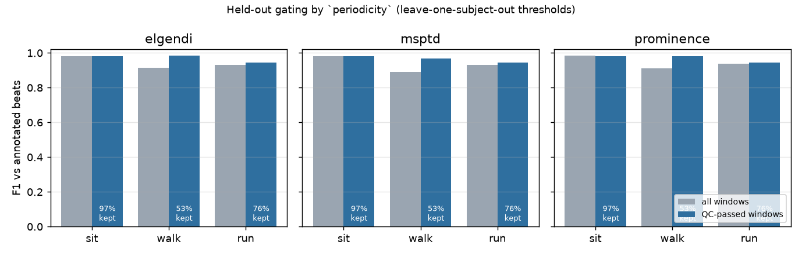
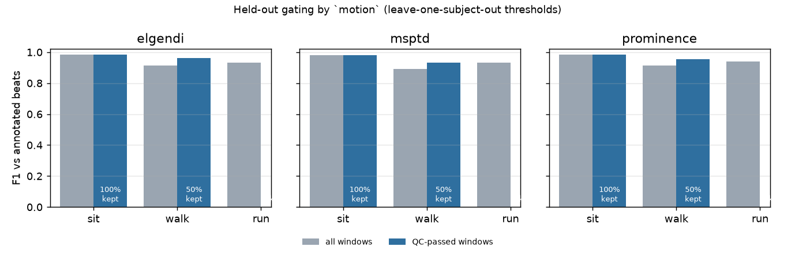
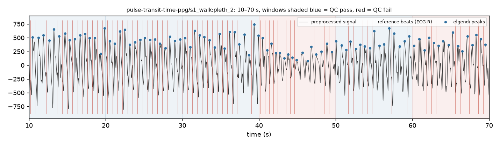
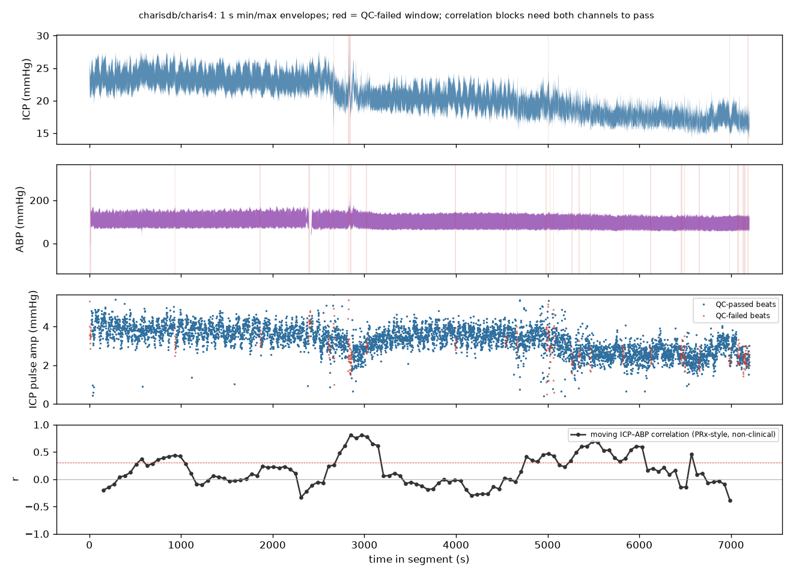

# pulse-qc

A small, tested harness for **data-quality gating and beat detection on open pulsatile
physiological waveforms**: finger PPG, and arterial and intracranial pressure from a
neuro-ICU. It fetches only the public PhysioNet records a config names, runs explicit,
versioned quality rules on every 10-second window, runs several beat detectors on the same
cached inputs, scores them against human-verified beat annotations with and without
gating, and chooses any tunable threshold on held-out subjects. Every result carries its
provenance.

## Why this exists

I care about brain and physiological monitoring, and the part of measurement I find most
interesting is the unglamorous one: deciding which stretches of a signal deserve to be
trusted before any headline number is computed from them. Three habits make that
tractable, and this repo is an exercise in all three.

- **Measurement trust is a first-class output.** Quality rules are declarative, versioned
  and tested; each window gets a pass/fail with a reason, and every downstream number is
  reported over all windows and over the windows that passed, so the effect of gating is
  visible rather than baked in.
- **Reprocessing is cheap.** Every stage is cached on the hash of its inputs, its config
  section and its own source code. Changing a threshold reruns the stages that depend on
  it and nothing else, and the run report says which stages ran.
- **Comparisons are easy to rerun.** A config is the unit of reproducibility; two configs
  that differ in one line give two run directories and a diff of scores. A new detector or
  rule is a decorated function, not a fork. Evaluation is something you call, not
  something you commission.

It is an engineering and analysis exercise. It is not research and it is not a product.

## Limits

- **Not a medical device, not validated, no clinical claims.** Nothing here has been
  evaluated for any clinical use. It is an educational and engineering demonstration.
- **Small evaluation set.** Six subjects, three activities each, from one dataset
  (the Pulse Transit Time PPG set). The numbers below describe those 18 records, not PPG
  in general.
- **The acquisition-fault rules never fire on the evaluation data.** Dropout, gaps,
  flatline, clipping and implausible range do catch things on the ICU recordings (BIDMC,
  CHARIS) but the lab-grade PTT-PPG recordings are clean, so the only rules that change
  the PPG scores are two heuristics: signal `periodicity` and accelerometer `motion`.
  Their thresholds are chosen leave-one-subject-out and the held-out numbers are the ones
  quoted here. Both buy their gain by discarding windows: a quarter of them for
  periodicity, half for motion. Neither explains the running errors.
- **Reference beats are ECG R-peaks, not PPG peaks.** The scorer removes one constant
  lag per record (the median R-to-pulse delay, about 0.3 s here) and then matches within
  ±100 ms. Beat-to-beat changes in pulse arrival time count against the detector.
- **The neuro-ICU part is a pattern demonstration, not an index.** The ICP–ABP moving
  correlation in the CHARIS run is a textbook PRx-*style* calculation on 50 Hz data with a
  naive quality gate. It is not the validated clinical PRx, it is computed on 2-hour
  segments of three patients, and the ICP sub-peaks (P1/P2/P3) are not resolvable at this
  sampling rate. No clinical meaning should be read into any number in that section.
- **No cerebral blood flow signal.** The datasets have ICP and ABP but no CBF; the link to
  optical brain monitoring is the shared problem (pulsatile waveforms, trust before
  metrics), not the signal.

## Results

### Beat detection on PTT-PPG, with held-out gating

18 records from PhysioNet's Pulse Transit Time PPG dataset (infrared channel `pleth_2`,
500 Hz, subjects 1–6, sitting / walking / running), 13,653 annotated beats in 891 windows
of 10 s. Tolerance ±100 ms after per-record lag removal. Gating is **held-out**: for each
subject the `periodicity` threshold was chosen on the other five (it came out at 0.60–0.65
in every fold), then applied to that subject; the table pools the held-out windows.

| detector | activity | beats | F1 all windows | F1 QC-passed (held-out) | beats kept |
|---|---|---|---|---|---|
| elgendi (NeuroKit2) | all | 13,653 | 0.942 | 0.969 | 74% |
| elgendi | sit | 4,131 | 0.983 | 0.982 | 97% |
| elgendi | walk | 4,717 | 0.915 | 0.983 | 53% |
| elgendi | run | 4,805 | 0.933 | 0.944 | 76% |
| msptd (NeuroKit2) | all | 13,653 | 0.933 | 0.965 | 74% |
| msptd | sit | 4,131 | 0.980 | 0.980 | 97% |
| msptd | walk | 4,717 | 0.893 | 0.969 | 53% |
| msptd | run | 4,805 | 0.931 | 0.944 | 76% |
| prominence (scipy baseline) | all | 13,653 | 0.943 | 0.969 | 74% |
| prominence | sit | 4,131 | 0.983 | 0.983 | 97% |
| prominence | walk | 4,717 | 0.912 | 0.982 | 53% |
| prominence | run | 4,805 | 0.939 | 0.944 | 76% |

What I take from this: the three detectors are within a point of each other once the
signal is preprocessed the same way, the simple baseline included; walking hurts more than
running on this data; and a periodicity gate chosen on other subjects lifts walking F1
from about 0.91 to 0.98, but only by throwing away nearly half of the walking windows.
Whether that trade is worth it depends entirely on what the beats are for. Median absolute
timing error after lag removal is 8–12 ms, so the misses are missed or spurious beats, not
jitter.



The shipped `configs/ptt-ppg.yaml` applies both heuristics at their held-out consensus
thresholds so that they can be compared on one run; in-sample that keeps 342 of 891
windows and scores F1 0.985 on them. Each run's `report.md` is the in-sample view;
`pulse-qc holdout <run>` writes the held-out one.

### Does motion explain the errors better than periodicity?

The PTT-PPG device carries an accelerometer, so there is a second, independent way to
gate: a `motion` rule that fails a window when the standard deviation of the acceleration
magnitude exceeds a threshold. Same windows, same beats, same leave-one-subject-out
protocol. AUC is how well the raw rule value ranks the bad windows (mean beat F1 below
0.9) within that activity.

| activity | AUC motion | AUC periodicity | F1 all | F1 passed (motion) | beats kept | F1 passed (periodicity) | beats kept |
|---|---|---|---|---|---|---|---|
| sit | 0.74 | 0.49 | 0.982 | 0.982 | 100% | 0.982 | 97% |
| walk | 0.73 | 0.88 | 0.906 | 0.950 | 50% | 0.978 | 53% |
| run | 0.64 | 0.63 | 0.934 | – | 0% | 0.944 | 76% |
| all | 0.72 | 0.77 | 0.939 | 0.971 | 47% | 0.967 | 74% |

The accelerometer tells you *whether the subject was moving*, which is not the same as
whether beat detection failed. Motion is uniformly high while running (0.9–5 g RMS) yet
most running windows detect fine (F1 0.93), so any motion threshold that removes the bad
walking windows removes every running window too. Within an activity, the signal's own
periodicity ranks the bad walking windows better (AUC 0.88 vs 0.73), and neither rule
ranks the running errors well (0.63 vs 0.64). Motion wins only while sitting, where there
is almost nothing to fix. On this data the signal-derived rule is the more useful gate,
and the running errors are not explained by either rule yet.





`configs/bidmc.yaml` runs the same rules and detectors on five BIDMC ICU PPG records,
which have no beat annotations: there the acquisition rules do fire (clipping and flatline
on a couple of windows) and the report shows detection counts only.

### Neuro-ICU waveforms (CHARIS, non-clinical)

`configs/charis.yaml` streams a 2-hour segment of ICP and ABP from three CHARIS neuro-ICU
records (about 1.5 MB each over HTTP range requests, no 70 MB downloads), gates each
channel with its own plausible range, then computes per-beat pulse amplitude and a
PRx-style moving ICP–ABP correlation (Pearson r of 10 s means over 5-minute blocks,
stepped by 1 minute) in which a block is only valid if at least 80% of its windows passed
QC on *both* channels.

| record (2 h segment) | ICP windows passed | ABP windows passed | median ICP (mmHg) | median ICP pulse amp (mmHg) | valid correlation blocks | median r |
|---|---|---|---|---|---|---|
| charis1 | 330 / 720 | 639 / 720 | 13.5 | 1.30 | 0 / 116 | – |
| charis4 | 713 / 720 | 686 / 720 | 20.7 | 3.37 | 115 / 116 | 0.11 |
| charis7 | 720 / 720 | 720 / 720 | 15.4 | 4.45 | 116 / 116 | 0.07 |

The first row is the point of the exercise. In charis1 the ICP pulse is about 1.3 mmHg and
irregular, the periodicity gate rejected more than half of the ICP windows, and so no
5-minute block had enough clean data on both channels: the harness returns no correlation
rather than a dubious one. The ABP channel in that record also carried two windows outside
20–250 mmHg (a flushed or disconnected line reads near zero), which the plausible-range
rule caught.



The full tables, provenance JSON (git SHA, package versions, config hash, record IDs and
file checksums) and figures for every run are written to `runs/<name>-<confighash>/`.

## Quickstart

Requires Python 3.12 and [uv](https://docs.astral.sh/uv/). If you use
[mise](https://mise.jdx.dev/), `mise install` picks up the pinned Python.

```bash
uv sync --all-groups
uv run pytest                                  # synthetic fixtures only, no network
uv run pulse-qc run configs/synthetic.yaml     # end-to-end on generated signals

# Real data: downloads ~90 MB from PhysioNet into data/raw/ (git-ignored),
# verifies every file against the published SHA256SUMS, and caches each stage.
uv run pulse-qc run configs/ptt-ppg.yaml
uv run pulse-qc holdout runs/ptt-ppg-<hash> --rule periodicity --rule motion
uv run pulse-qc run configs/charis.yaml        # streams 3 x 2 h of ICP/ABP, ~5 MB total
uv run pulse-qc compare configs/ptt-ppg-acquisition-only.yaml configs/ptt-ppg.yaml
uv run pulse-qc report runs/ptt-ppg-<hash>     # regenerate report.md and figures
```

## Use it from Python

The CLI is a thin layer over a few functions. A comparison that another person, or an
agent, can run without touching internals:

```python
import pulse_qc

result = pulse_qc.evaluate("configs/ptt-ppg.yaml")        # cached; a second call is instant
print(result.gating_table())                               # F1 all / QC-passed / QC-failed
result.provenance["git"]                                   # sha, dirty flag, packages, record hashes

@pulse_qc.register_detector("my_peaks")
def my_peaks(y, fs, *, min_rr_s=0.3):
    ...                                                    # return peak sample indices

variant = pulse_qc.evaluate("configs/ptt-ppg.yaml", detectors=["elgendi", "my_peaks"],
                            name="my-variant")
print(pulse_qc.compare("configs/ptt-ppg.yaml", variant.config))
```

`register_rule` does the same for quality rules, including the held-out threshold
tuning. [docs/adding-a-detector.md](docs/adding-a-detector.md) is the walkthrough and
`examples/custom_detector.py` a runnable version of it.

## How it works

```
load ──▶ preprocess ──▶ detect (×N) ──▶ score (×N) ──▶ report / holdout
  └────▶ qc ────────────────────────────┘      └──▶ neuro (ICP/ABP pairs)
```

- **Ingest** (`ingest.py`): fetches only the named WFDB files, checks them against the
  dataset's `SHA256SUMS.txt`, reads one channel plus the beat annotations and any
  auxiliary channels a rule needs. Long records are streamed as a time segment over HTTP
  range requests instead of downloaded. Demographic header fields are dropped on read.
- **QC rules** (`qc/rules.py`): pure functions of one window and the sampling rate,
  registered by name, parametrised from YAML: `nan_dropout`, `sampling_gap`, `flatline`,
  `clipping`, `plausible_range`, `periodicity`, and `motion` (which reads auxiliary
  accelerometer channels). Each returns pass/fail, the value the decision was made on, and
  a reason string. Every rule has unit tests on synthetic signals with injected faults.
- **Cache** (`cache.py`): every stage result is stored under a key made from the raw file
  hashes, the relevant config section, and the source code of the stage. Changing a QC
  threshold reruns `qc` and scoring but not `preprocess` or `detect`; adding a detector
  reruns only that detector. The tests assert exactly which stages rerun, and each run's
  report lists cache hits and misses per stage.
- **Detectors** (`detect.py`): NeuroKit2's Elgendi and MSPTD (Charlton) methods and a
  deliberately plain `scipy.signal.find_peaks` baseline, all on the same preprocessed
  signal (NaN interpolation, 0.5–8 Hz zero-phase band-pass, polarity flip for raw
  reflectance PPG). All linear in record length.
- **Scoring** (`scoring.py`): per-record lag estimate, greedy one-to-one matching within
  a tolerance, counts attributed per window so the same detections can be scored over all
  windows, QC-passed windows, or by activity.
- **Hold-out** (`holdout.py`): leave-one-subject-out choice of a rule's threshold
  (Youden's J for flagging windows whose beat F1 is below 0.9), scored on the held-out
  subjects only, with a side-by-side comparison when more than one rule is tuned.
- **Neuro features** (`neuro.py`): per-beat pulse amplitude and the masked moving
  ICP–ABP correlation, paired by record name, cached like every other stage.
- **Report** (`report.py`): Markdown, figures, `provenance.json`.
- **API** (`api.py`): `evaluate`, `compare`, `register_detector`, `register_rule`; a
  config may also list `plugins:` modules to import before a run.

## Data and licences

No PhysioNet data is stored in this repository. The pipeline downloads what a config
names into `data/raw/`, which is git-ignored. The test-suite and CI use only small
synthetic fixtures generated in `synth.py`.

**Pulse Transit Time PPG Dataset** (v1.1.0), licensed under the
[Open Data Commons Open Database License v1.0 (ODbL)](https://opendatacommons.org/licenses/odbl/1-0/).
Mehrgardt, P., Khushi, M., Poon, S., & Withana, A. (2022). Pulse Transit Time PPG Dataset
(version 1.1.0). PhysioNet. https://doi.org/10.13026/jpan-6n92.
*Share-alike note:* the per-window tables a run writes for this dataset
(`window_qc.csv`, `beat_counts.csv`, `lags.csv`, `summary.csv`, `holdout_*.csv`) are
derived from an ODbL database. If you publish them, they are available under ODbL 1.0;
the summary numbers reproduced in this README are likewise offered under ODbL 1.0. They
are not committed here.

**CHARIS database** (v1.0.0), licensed under ODC-By 1.0. Kim, N., Krasner, A., Kosinski,
C., Wininger, M., Qadri, M., Kappus, Z., Danish, S., & Craelius, W. (2016). Trending
autoregulatory indices during treatment for traumatic brain injury. Journal of Clinical
Monitoring and Computing, 30(6), 821–831. https://doi.org/10.1007/s10877-015-9779-3.
Only 2-hour segments of three records are read; demographic and outcome fields in the
headers are discarded at ingest and nothing is joined to them.

**BIDMC PPG and Respiration Dataset** (v1.0.0), licensed under the
[Open Data Commons Attribution License v1.0 (ODC-By)](https://opendatacommons.org/licenses/by/1-0/).
Pimentel, M.A.F. et al. Towards a Robust Estimation of Respiratory Rate from Pulse
Oximeters. IEEE Transactions on Biomedical Engineering, 64(8), pp. 1914–1923, 2017.
https://doi.org/10.1109/TBME.2016.2613124.

All via PhysioNet: Pollard, T., Moody, B. E., Lehman, L., Gow, B., Fernandes, C., Xie,
C., Johnson, A., Mark, R. G., & Heldt, T. (2026). PhysioNet as a global platform for
biomedical research. Nature Health. https://doi.org/10.1038/s44360-026-00096-z.

Beat detectors: Elgendi, M. et al. (2013), Systolic peak detection in acceleration
photoplethysmograms measured from emergency responders in tropical conditions, PLoS ONE
8(10); Charlton, P. H. et al. (2022), Detecting beats in the photoplethysmogram: benchmarking
open-source algorithms, Physiological Measurement 43(8); both as implemented in
[NeuroKit2](https://github.com/neuropsychology/NeuroKit) (MIT). WFDB reading via
[wfdb-python](https://github.com/MIT-LCP/wfdb-python) (MIT).

## Licence

Code is MIT, Copyright (c) 2026 Nima Pourtaheri. See `LICENSE`. Datasets keep their own
licences as above.

## Next

- A rule that explains the running errors; neither motion nor periodicity does. The IMU
  has gyroscope channels and the device has attachment-pressure load cells, both unused.
- More subjects: the PTT-PPG set has 22, this uses 6.
- ICP pulse morphology needs more than 50 Hz; a higher-rate ICP source would make the
  per-beat features meaningful.
